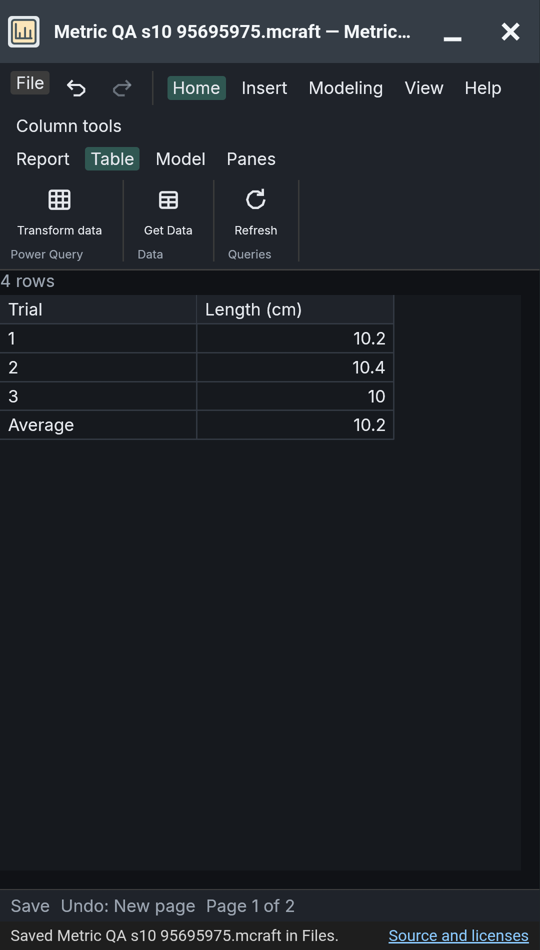

# MetricCraft on WebOS

In the **Office** menu, open **MetricCraft**. The browser edition uses WebGL 2. Follow the native build instructions to produce the Rust WASM module. The WebOS adapter connects the editor to My files. Signed-in work is saved to the account and a guest can reopen temporary work during the same session. [MetricCraft build and source](https://github.com/CC-David-CC/metriccraft/tree/0fa962194bd99bdcd44dc6ba29ef290d597bc2f8#webos-browser-preview)

## Core phone workflow

1. Choose **Home → Get Data**, open **Documents**, and import a small CSV with trial and length columns.
2. Repeat with an Excel workbook and choose its worksheet. Repeat with a small Parquet file. The test uses a four-row CSV, the Measurements worksheet, and a two-row Parquet file.
3. Create **Page 1**. Select **File → Save as**. The suggested filename is `Untitled.mcraft`. Cancel the folder picker, retry, choose **Documents**, and save under a bare name. My files shows the same name with the `.mcraft` extension.
4. Sign in again in a fresh browser session and open the report by selecting it in My files and choosing **Open**. Add a second page and choose **File → Save**. In **Table**, verify the original values are available.

Tested on the physical Galaxy S10+ with Chrome 158.0.8127.92 at 411 CSS px, and in Chromium at 820 and 1300 CSS px. The one-page and two-page packages contain the same three source files. Each embedded file matches its recorded SHA-256 digest. The phone Table view displayed trial 2 at 10.4 cm after reopening and resaving. The dark status text measured 11.25:1 against its background.



## Release and remaining checks

The core phone workflow passed in viewer `0901c5fd19402eaf4f4c1292a88b6b9060ea07b83296e677d442b75e6ecf73f7`. Hosted Chromium repeated all three imports, editing, Files save, reopen and resave as a guest. Reload cleared the temporary guest report. The deployed adapter source is `29eb23b4679fc20385589ccf393400fb0e428dbd`.

With side panes open at tablet width, the report page-tab plus overlaps the zoom controls. **Insert → New page** works at that width. The core checks cover data import, browsing, report page editing and editable Files storage. Chart authoring, Power Query transforms and desktop modeling parity have separate checks.

On box-webhost, the following restores viewer `8ba9fd0bb526`.

```sh
sudo python3 -I -B /var/backups/webos-metriccraft-status-layout-0901c5fd1940/deploy-viewer.py rollback
```
