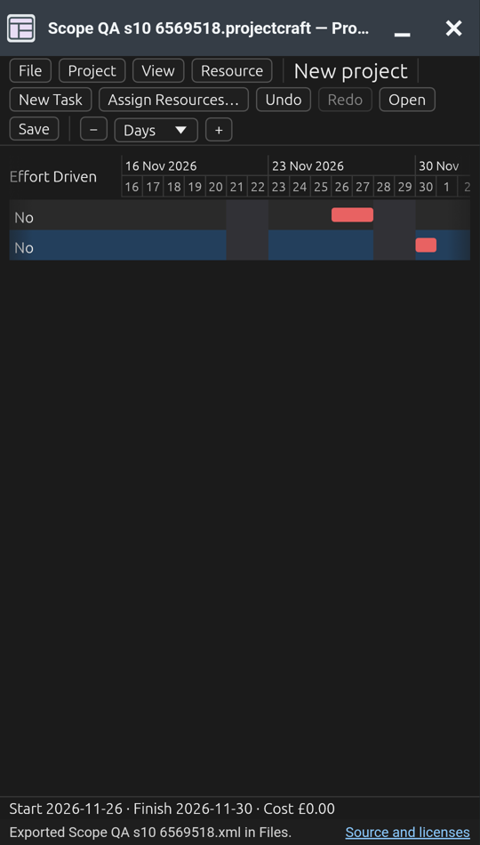
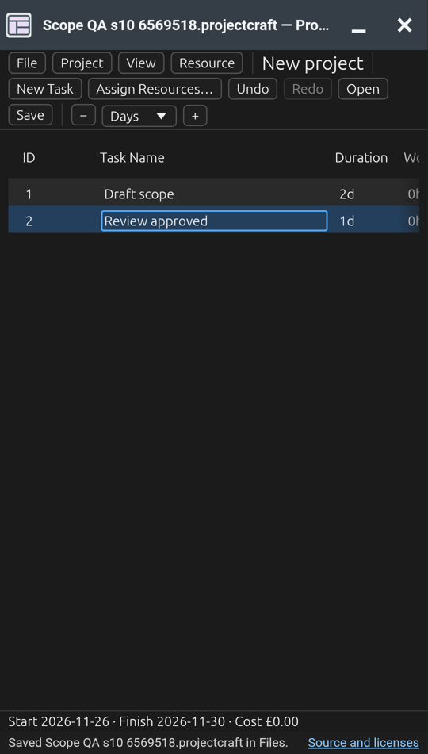

# ProjectCraft on WebOS

Open **Office → ProjectCraft** in a browser with WebAssembly and WebGPU support. Use My files to keep editable projects across sign-ins. Guest projects are available within the current page session. [Browser requirements and Rust WASM build](https://github.com/CC-David-CC/projectcraft/tree/251f396e341b370068efad5e723ed6f2f38a545f#browser-build)

## Core phone workflow

1. Tap **New Task** twice. Double-tap a task name or duration to edit it with the phone keyboard. Create **Draft scope** for two days and **Review scope** for one day.
2. Swipe left across a task row to **Predecessors**. Double-tap the second task's cell, enter `1`, and commit the edit. Swipe further across the rows to reach the Gantt chart. With the standard Monday–Friday calendar, the review starts on the first workday after the draft finishes.
3. Choose **File → Save As**. Cancel once and retry. Use **Documents**, then enter a name without an extension. My files shows the saved `.projectcraft` file.
4. Use **File → Export** for a CSV and a Microsoft Project XML copy. Both copies contain the two tasks, dates and dependency. Open each from ProjectCraft's **File → Open** to import it.
5. Sign in again in a fresh browser session. In My files, select the native project and choose **Open**. Rename the second task to **Review approved** and save to the same file.

The S10+ ran Chrome 158.0.8127.92 at 411 CSS pixels. The keyboard opened during task editing. The two-day task ran November 26–27, 2026 and the dependent task ran November 30 after the weekend. Both exports carried those dates. The resaved project's calendar, durations and dependency matched the original. Chromium at 820 and 1300 CSS pixels repeated the edit, export, open and resave. Dark file-status contrast measured 11.25:1.





## Coverage and rollback

The phone workflow covers task editing, dependencies and scheduling, native project storage, and CSV/XML exchange. The wider follow-ups cover working calendars, resource assignments, cost and leveling, and tracking and recovery. At phone width, the task names and timeline occupy separate horizontally scrolled views.

Validated against viewer `ee39f4de7bb845dee1837b7fd460303921d34b66e317b9c429d31ed9312b8fd9` and Desktop adapter `77daaa656e862164dab823e8c8d9f78448df2975`. The native ProjectCraft source is `251f396e341b370068efad5e723ed6f2f38a545f`.

On box-webhost, this restores viewer `0901c5fd1940`.

```sh
sudo python3 -I -B /var/backups/webos-projectcraft-phone-files-ee39f4de7bb8/deploy-viewer.py rollback
```
